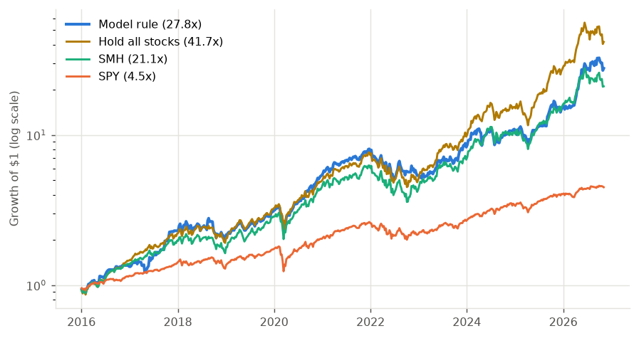

# Model test report

_Generated 2026-11-16 03:49 UTC. Data through 2026-11-13._

## Verdict

**No reliable edge. The model is not distinguishable from a coin flip / simple baselines once you account for noise.**

- Out-of-sample accuracy 54.2% vs 56.0% for simply guessing 'up' every time (difference -1.9%, 90% range -2.6% to -1.0%).
- ROC AUC 0.503 (0.5 = no skill; 90% range 0.488-0.518); best simple baseline AUC 0.505.
- The 10-90% range caught the actual move 79% of the time after calibration (target 80%).
- Backtest after costs: 37.3%/yr (Sharpe 1.17) vs 42.7%/yr (Sharpe 1.31) for just holding all the stocks. The rule did NOT beat simply holding the stocks on risk-adjusted terms.

## Direction (out-of-sample)

| model | accuracy | auc | brier |
|---|---|---|---|
| Baseline: always up | 56.0% | 0.500 | 0.2466 |
| Baseline: last week repeats | 50.1% | 0.493 | 0.4994 |
| Baseline: historical average | 56.0% | 0.505 | 0.2467 |
| Logistic regression | 54.2% | 0.503 | 0.2498 |
| LightGBM | 54.4% | 0.494 | 0.2506 |

## Ranges (target coverage 80%)

| model | coverage | median_width | pinball |
|---|---|---|---|
| Baseline (volatility only) | 79.8% | 13.3% | 0.01563 |
| LightGBM (raw) | 75.5% | 11.5% | 0.01548 |
| LightGBM (calibrated) | 78.7% | 12.5% |  |

## Backtest

|  | CAGR | Volatility | Sharpe | Max drawdown | Total return | % weeks invested |
|---|---|---|---|---|---|---|
| Model rule (after costs) | 37.3% | 31.4% | 1.17 | -38.2% | 2683.9% | 88.6% |
| Hold all stocks (equal weight) | 42.7% | 30.7% | 1.31 | -41.2% | 4072.2% |  |
| Buy & hold SPY | 15.4% | 16.5% | 0.95 | -31.7% | 349.5% |  |
| Buy & hold SMH | 33.7% | 30.2% | 1.12 | -42.8% | 2011.1% |  |

Full report with charts: see `docs/report.html` / your GitHub Pages link.
